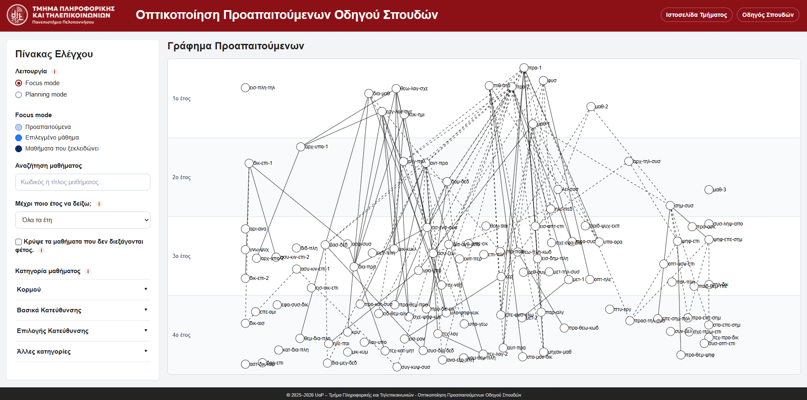
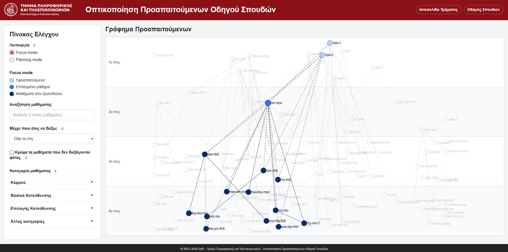
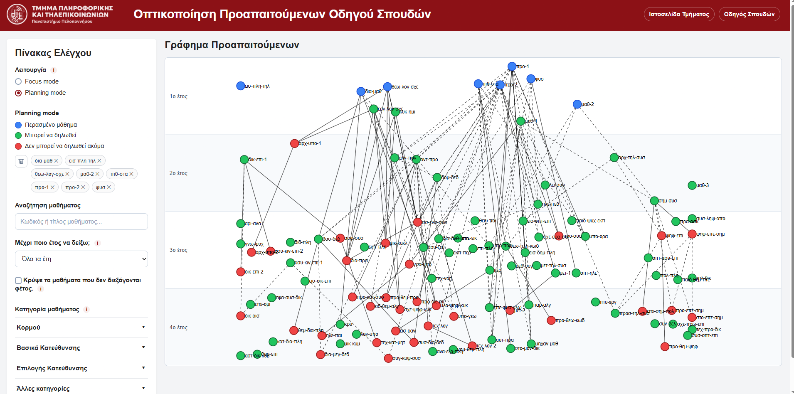

# Course Prerequisites Visualization

An interactive web application for visualizing course prerequisites and helping students explore and plan their academic progress.

Developed as an undergraduate thesis at the **Department of Informatics and Telecommunications, University of the Peloponnese**.

## Live Demo

**[Explore the Interactive Application](https://graphics.dit.uop.gr/prereqs/)**

The application is hosted by the Department of Informatics and Telecommunications at the University of the Peloponnese.

## Overview

University curricula often contain complex prerequisite relationships that can be difficult to understand through traditional course guides.

This application provides an interactive graph-based visualization of courses and their dependencies, allowing students to explore prerequisite relationships and make more informed decisions about their academic progress.

## Features

- **Interactive Course Graph:** Visualizes courses as nodes and prerequisite relationships as connections, organized by academic year.
- **AND / OR Prerequisites:** Distinguishes between mandatory prerequisite combinations and alternative prerequisites using different connection styles.
- **Focus Mode:** Highlights a selected course, its direct and indirect prerequisites, and the courses that depend on it.
- **Planning Mode:** Allows students to mark completed courses and explore which courses are available based on their academic progress.
- **Search & Filtering:** Supports course searches and filtering by academic year, course category, and other criteria.
- **Course Information:** Displays additional details about individual courses.

## Screenshots

### Application Overview

### Focus Mode

### Planning Mode

## Tech Stack

HTML · CSS · JavaScript · D3.js · PHP · SQLite

**Note:** The original SQLite database is not included in this repository.

## Academic Context

This project was developed as part of my undergraduate thesis:

**Thesis Title:** Visualization of Course Prerequisites in an Academic Curriculum

**University:** University of the Peloponnese

**Department:** Informatics and Telecommunications

**Supervisor:** Nikolaos Platis

**Development Period:** November 2025 – October 2026

## Documentation

The full thesis report is available in Greek and provides more details about the project's design, development, and features.

[Read the Full Thesis Report (PDF)](docs/thesis-report.pdf)

## Author

**Vaia Gegianni**
